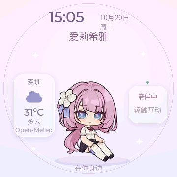

# AI Pet Badge · 爱莉希雅桌面陪伴原型

基于微雪 ESP32-S3-Touch-LCD-1.85B 的课程项目。当前支持爱莉希雅与青岚两套角色、时间日期、深圳天气、静止待机、触摸动画和摇晃头晕星星。按 2026-10-29 的要求，关闭陀螺仪采样、屏幕跟随旋转和倾斜偏移，固定显示朝向；中文语音对话将在后续阶段接入。

## 实机界面



另有 [青岚角色导入](docs/QINGLAN_IMPORT.md)：站姿静止待机、触摸跑步/跳跃/挥手，独立素材包与构建选项。两套固定朝向固件的导出、USB 切换与 SD 卡诊断见 [固定朝向版](docs/FIXED_SCREEN_2026-10-29.md)。

## 硬件与显示

- 360 × 360 圆屏，16 MiB Flash，8 MiB PSRAM。
- 行走、跳跃、坐下三个动作，视频去绿幕后按站姿身高、脚底位置对齐，目标 24 FPS。
- 背景、卡片和阴影预先合成，实时文字变化时更新界面缓存；RGB565 场景固定朝向，头晕时只变换人物并叠加星星。
- v2 素材暂存 Flash，160×256 RGB565＋A8 逐帧 zlib 压缩，当前包约 5.94MB；PSRAM 保存场景双缓冲、界面缓存及人物过渡缓冲，不依赖 TF 卡。
- 开机停留在坐下素材的最后一帧；待机时停止解码和刷新动画。
- 点击按行走、跳跃、坐下依次选择互动：先起身，再执行一次动作，最后坐下静止。坐下互动为起身后再次坐下。
- 起身复用坐下素材倒放；删去原视频开头、结尾的长停顿，相邻站姿用约 0.25 秒缓动混合衔接。
- 动作途中点击不会截断当前动作；只保留最后一次待执行请求，坐下后再开始，避免连续点击积压。
- 明显来回摇晃优先进入静音头晕并取消当前和排队动作，3 秒后恢复；爱莉希雅恢复坐姿，青岚恢复站姿，恢复与冷却期间抑制重复触发。
- QMI8658 只启用加速度计检测摇晃，陀螺仪关闭。人物、姓名、时间和天气固定朝向，轻倾斜不移动人物；旧正向校准保留在 NVS，但不再应用。
- 中文名字使用完整的四字字体子集，天气使用独立图标；字体来源与许可见 firmware/ai_pet_badge/licenses/fonts。
- USB 诊断命令为 STATUS、NEXT、TONE、DASH、SD、SHOT、TIME、IMU、IMU SELFTEST、IMU BENCH。IMU CALIBRATE 保留兼容响应，提示固定屏幕无需校准。TONE 只用于手动扬声器测试，IMU BENCH 仅由 USB 显式启动 10 秒固定朝向星星压测；SD 只挂载和读取，不自动格式化。

## 时间与天气

复制 .env.wifi.example 为本地 .env.wifi，填写 WIFI_SSID 和 WIFI_PASSWORD 后重新构建。使用 2.4 GHz 网络；构建脚本生成的 wifi_config.h 与本地配置均被 Git 忽略。生成的设备固件含网络配置，应留在本地。

联网后通过 NTP 校准北京时间，并写入板上 PCF85063A 时钟。时钟有效时，重启会优先从 RTC 恢复；断电后 RTC 数据无效则等待重新校时。未校准时显示占位符。

天气来自 [Open-Meteo](https://open-meteo.com/en/docs)，显示深圳的当前温度、天气描述和图标，每 15 分钟更新；请求失败每分钟重试。接口数据为天气模型的当前条件。无数据时显示同步状态，数据超过一小时显示“待更新”。城市坐标配置位于 badge_network.c。TLS 使用 ESP-IDF 证书包验证服务器。

## 构建与烧录

使用 ESP-IDF **5.5.3**。组件版本在 main/idf_component.yml 和 dependencies.lock 中固定。板级驱动来自 Waveshare 官方仓库提交 139e6db584f3737fcfc6a958ee83b79fb69d317c，保留各文件的上游许可。

工程路径需无空格。Windows SDK 入口见 tools/Enter-Idf.ps1，安装目录不同时调整该脚本。

```powershell
py -3.11 -m venv .venv
& .\.venv\Scripts\python.exe -m pip install -r tools\requirements-assets.txt
.\tools\Build-Badge.ps1 -AssetSource 'D:\AI Pet Badge\donz' -Flash -Port COM9
```

素材目录中需要 walk.mp4、jump.mp4、sit.mp4；v2 素材包已生成时可以省略 -AssetSource。旧版素材包需要重新转换，固件会明确拒绝 v1。COM9 是本次实机识别结果，其他机器请先确认端口。脚本按本次构建产生的 flash_args 烧录。

转换参数针对当前 donz 素材：sit.mp4 取 1.0–3.1 秒并以 1.4 倍速播放，站姿高 190 像素、脚底位于 y=310，为表盘和天气卡片留出空间。更换视频时调整 tools/prepare_badge_assets.py 的参数并检查 artifacts/assets/preview 中的 sequence-*.webp 和 aligned-poses.png，避免人物越界或姿势不匹配。

```powershell
. .\tools\Enter-Idf.ps1
python tools\board_console.py --port COM9 --reset --seconds 15 --output artifacts\boot.log
python tools\board_console.py --port COM9 --command STATUS --seconds 3 --output artifacts\status.log
python tools\board_console.py --port COM9 --command DASH --seconds 3 --output artifacts\dashboard.log
# Optional: set the clock from this computer when NTP is unavailable.
python tools\board_console.py --port COM9 --sync-time --seconds 3 --output artifacts\clock.log
# Capture the real LVGL screen with the desktop .venv.
.\.venv\Scripts\python.exe tools\capture_badge.py --port COM9 --output artifacts\screen.png
```

STATUS 包含 stage、action、pending、completed 和 late_frames，可观察动作顺序及帧调度是否超时，并包含 IMU 可用状态、朝向、平放、摇晃和头晕状态。设备静止、界面文字没有变化时，坐姿待机的 frames 应保持不变；该计数反映提交给 LVGL 的帧，屏幕观感仍需实机确认。体感阈值、校准、回放测试和实机验收见 [IMU_INTERACTION.md](docs/IMU_INTERACTION.md)。

字体子集已包含在源码中。如修改界面文字，在已下载固定版本 LVGL 组件的工程中运行 npm install --prefix tools/fonts，再用 .venv 执行 tools/prepare_badge_fonts.py。请同步保留上游字体许可。

## 目录

音色复刻已准备本地 Key 检查、样本提交和 WAV 试听工具，操作见 [VOICE_CLONING.md](docs/VOICE_CLONING.md)。真实 API 鉴权及音色试听仍待本地配置和样本验证。

- firmware/ai_pet_badge：自研应用与板级组件。
- tools：素材转换、构建与 USB 诊断工具。
- backend：语音后端环境准备，业务链路待接入。
- docs/MVP_PLAN.md：已确认范围、协作方式与阶段安排。

原始角色视频、声音样本、密钥、生成的动画包和构建输出保留在本地；源码仓库包含转换流程与配置样例。
